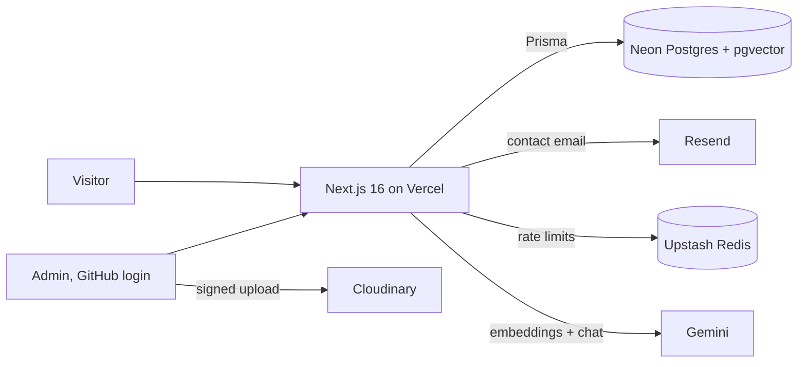

# Muhammad Usman | AI Engineer Portfolio

A full-stack portfolio that is itself a portfolio project: a 3D hero, case studies of real projects,
a private admin dashboard and an "Ask about my work" RAG chatbot.

**Live:** https://portfolio-gamma-rust-65.vercel.app · Build plan: [docs/PLAN.md](docs/PLAN.md)

## Projects featured

- **IntelliMeet**: video meetings with live speech-to-speech translation, so an Urdu speaker and an
  English speaker each hear the other in their own language (about 1.8 s from speaker to listener).
- **JobPilot**: turns a resume into a ranked shortlist of real job listings and fact-checked
  application drafts, and never sends anything without the user's click.

## Architecture



| Layer     | Choice                                                                    |
| --------- | ------------------------------------------------------------------------- |
| Framework | Next.js 16 (App Router, Cache Components), TypeScript                     |
| UI        | Tailwind CSS v4, shadcn/ui, Framer Motion, three.js via React Three Fiber |
| Data      | Prisma 7 + Neon Postgres, pgvector (HNSW index) for chatbot retrieval     |
| Auth      | Auth.js v5, GitHub OAuth, one allowed account                             |
| AI        | Vercel AI SDK v7, Gemini (`gemini-embedding-001` at 768 dims, chat model) |
| Services  | Resend (email), Upstash (rate limiting), Cloudinary (images)              |
| Quality   | Zod everywhere, Vitest, Playwright, GitHub Actions, Vercel Analytics      |

## How the pieces work

**Content.** Pages read from `lib/content.ts`. With a database configured it serves Postgres rows
through `"use cache"` functions tagged `projects` / `posts`; admin changes call `updateTag`, so the
public site updates instantly while staying static. Without a database it falls back to the
write-ups in `lib/data`, which is also what CI builds against.

**Admin.** `/admin` is protected twice: `proxy.ts` redirects signed-out visitors, and every admin
page and server action calls `requireAdmin()`. Projects and posts have validated forms, posts have
an MDX editor whose preview uses the same renderer as the blog, and messages have an inbox.

**Chatbot (RAG).** "Rebuild AI knowledge" in the admin chunks the profile, projects and posts,
embeds them with Gemini and stores them in pgvector. Each question is embedded, the five closest
chunks are retrieved by cosine distance, and Gemini answers under a strict prompt (only these
facts, "I don't know" otherwise) with source links. Per-visitor and daily caps protect the bill.

**3D hero on a budget.** About 80 nodes around the portrait (40 on modest machines), drawn as one instanced mesh
plus one line geometry. three.js loads only after the page is idle on desktop, stops rendering off-screen, and
falls back to a gradient on phones, weak devices and for reduced motion.

Lighthouse on the live home page (with the 3D hero): Performance 80–87 mobile / 100 desktop;
Accessibility, Best practices and SEO 100. Layout shift is 0.

**Contact form.** Server action with Zod validation, a honeypot, 3 messages per 10 minutes per IP,
saved to the database first and then emailed, so nothing is lost if email fails.

## Run locally (no Docker)

Requirements: Node.js 22+ (developed on Node 24) and npm.

```bash
npm install
cp .env.example .env.local
npm run dev
```

Open http://localhost:3000. Every variable in `.env.example` is optional: without them the site runs
on static content, and each service switches on when its keys are added. With a Neon database:

```bash
npm run db:deploy
npm run db:seed
```

| Script              | What it does                                 |
| ------------------- | -------------------------------------------- |
| `npm run dev`       | Dev server                                   |
| `npm run build`     | Production build                             |
| `npm run lint`      | ESLint                                       |
| `npm run typecheck` | TypeScript, no emit                          |
| `npm test`          | Unit tests (Vitest)                          |
| `npm run test:e2e`  | End-to-end tests (Playwright, needs a build) |
| `npm run db:deploy` | Apply database migrations                    |
| `npm run db:seed`   | Load the project write-ups into the database |
| `npm run db:studio` | Browse the database                          |

CI (GitHub Actions) runs lint, type-check, unit tests, a production build and the Playwright suite
on desktop and mobile viewports for every push. Nothing in this project uses Docker.
